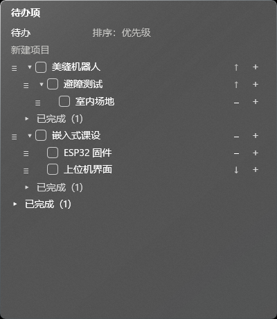
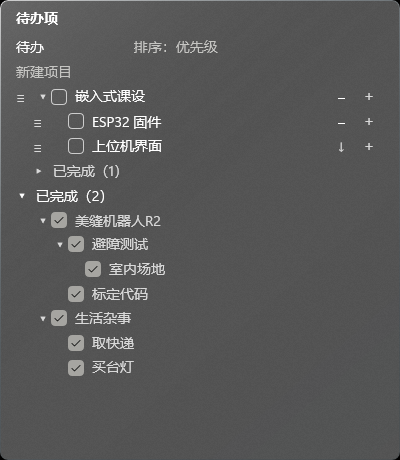

# PecoFence-Nested

Windows 桌面栅栏 [PecoFence](https://github.com/DayuanJiang/PecoFence) 的定制分支：便签里的待办支持**无限层级的大项目/小项目**，可以逐级勾选、逐级完成。

> 本仓库是个人定制分支，不是上游官方版本，不提供安装包、自动更新、Microsoft Store 或 winget 渠道。



## 这个分支改了什么

- 便签待办按正文缩进建树（每 2 空格一级，层数不限）：大项目里套小项目，小项目里还可以再套。
- 勾选会级联：勾父项连带全部后代；最后一条子项勾完时父项自动勾上，整组离开未完成区；取消任意后代，父链自动取消。
- 顶部「新建项目」建顶层项目，每行末尾的「＋」建子任务。
- 每级按优先级（高 / 普通 / 低）排序；同级可以改成手动顺序，拖拽或任务菜单的上移/下移只在同一个父项目内生效。
- 排序按钮点击直接切换「排序：优先级 ↔ 排序：手动」，切到手动时按当时屏幕上的顺序接上。
- 未完成父项里已完成的子项沉到本级最后，点「已完成 (N)」显示或隐藏，状态会保存。
- 全部完成的大项目整组进底部「已完成」，展开后是勾选的大项目套着勾选的小项目。



## 使用

1. 便签正文仍然是 `[ ]` / `[x]` 行，缩进 2 个空格就是上一行的子项目；旧便签不需要迁移，没有缩进就都是顶层。
2. 点复选框完成，点行尾「＋」新建子任务，点顶部「新建项目」新建顶层项目。**新建后会自动打开这个任务的详情，标题已选中**，直接打字就能改名。
3. 点任务文字打开任务详情，在详情里改标题、日期、提醒、优先级、颜色、标签、备注和附件。
4. 详情里点「删除」会先弹确认框（默认「否」）；确认后这个项目/待办**连同它下面的所有子任务**一起删除。
5. 改名只能走任务详情，因为本分支已移除便签全文编辑模式：点便签空白处不再进入编辑页。
6. 纯文字便签在界面里是只读的；需要改正文时用 CLI：

```powershell
pecofence-cli note set <便签> "<新的正文>"
```

## 构建

环境：Windows 10 1809+ 或 Windows 11 x64；Rust stable（MSVC 工具链）；Visual Studio Build Tools 的 Desktop development with C++；运行设置页需要 Microsoft Edge WebView2 Runtime。

```powershell
git clone https://github.com/ethan123-zhang/PecoFence-Nested.git
cd PecoFence-Nested
cargo build --release --locked --workspace --bins
Copy-Item third_party/webview2/WebView2Loader.x64.dll target/release/WebView2Loader.dll
```

产物都在 `target\release`：

- `pecofence.exe`
- `pecofence-cli.exe`
- `pecofence-watchdog.exe`
- `WebView2Loader.dll`（必须和 exe 放在同一目录）

四个文件放到同一个文件夹，运行 `pecofence.exe` 即可。更多构建与测试说明见 [docs/DEVELOPMENT.md](docs/DEVELOPMENT.md)。

## 安装 / 升级 / 回滚

- 升级：托盘退出旧版，把新构建的 `pecofence.exe`、`pecofence-cli.exe`、`pecofence-watchdog.exe` 覆盖到安装目录，重新启动。
- 配置默认在 `%APPDATA%\PecoFence\config.json`；用 `--portable` 启动时改存到 exe 同目录的 `config` 文件夹。
- 回滚：换回旧版 exe 即可。旧版本会忽略新增的可选配置字段，便签正文不受影响。

## 与上游的差别

| 项 | 行为 |
| :--- | :--- |
| 便签待办 | 从单层列表改为按缩进建树，支持无限层级、级联勾选、父项自动完成 |
| 新建任务 | 「新建项目」/行尾＋后自动打开任务详情并选中标题，直接打字改名 |
| 删除任务 | 删前弹原生确认框（默认「否」），确认后连该任务的全部子任务一起删 |
| 已完成 | 子项沉底并可折叠，顶层完成整组进底部「已完成」并递归显示 |
| 日期分区 | 显示上去掉了「今天 / 本周 / 以后 / 没有日期」，日期与提醒仍保留在任务详情 |
| 排序 | 每级按优先级排序；手动顺序只在同一父项目内；切手动时按当前可见顺序建立基线 |
| 便签编辑 | 移除全文编辑模式，点空白无反应；改名走任务详情 |
| 修复 | 勾选撤销回滚丢数据、非 2 空格缩进插入、优先级菜单误报、窄便签复选框误命中 |

其余上游功能（文件栅栏、整理规则、智能栅栏、CLI、设置、主题、快照等）保留。

## 已知限制

- 拖拽的完整交互只在单元测试里验证过，没有在受控环境里做 UI 自动化；建议第一次使用时在桌面上拖一次确认。
- 键盘 ↑↓ 换位没有做，目前用任务右键菜单的上移/下移。
- 底部全局「已完成 (N)」的展开状态不跨重启；每个项目里的「已完成 (N)」开关和折叠状态会保存。
- 没有发布包和自动更新，需要自行构建。
- 回到上游版本时，缩进的任务行会退化成普通待办并丢失层级，但正文本身不会丢。
- 纯文字便签在界面里不能改正文，只能通过 `pecofence-cli note set`。

## 数据与兼容

- 便签正文仍是唯一真源；层级由缩进决定，任务标题、勾选状态都写在正文里。
- 配置里新增可选的 `noteTasks` 字段（排序模式、手动顺序、折叠、已完成开关），旧配置可以直接读；删掉这个字段只影响排序/折叠状态，不影响正文。
- 旧的单层待办不需要迁移，打开就是顶层任务。

## 开发

```powershell
cargo fmt --all --check
cargo clippy --workspace --all-targets -- -D warnings
cargo test --workspace
```

本分支当前状态：`cargo test --workspace` 为 880 passed / 0 failed / 2 ignored；构建、验收和回滚记录见 [PROGRESS.md](PROGRESS.md) 与 [docs/handoffs/2026-11-24-pecofence-new-project-detail-delete-confirm.md](docs/handoffs/2026-11-24-pecofence-new-project-detail-delete-confirm.md)。

## 致谢与许可

- 基于 [DayuanJiang/PecoFence](https://github.com/DayuanJiang/PecoFence)（Apache License 2.0），本仓库保留上游的 `LICENSE` 与 `NOTICE`。
- 上游文档：[README](https://github.com/DayuanJiang/PecoFence#readme)、[开发指南](docs/DEVELOPMENT.md)、[CLI](docs/CLI.md)、[功能总表](docs/FEATURES.md)。
- 本分支的改动与问题记录见 [PROGRESS.md](PROGRESS.md)。

Apache License 2.0，见 [LICENSE](LICENSE)。